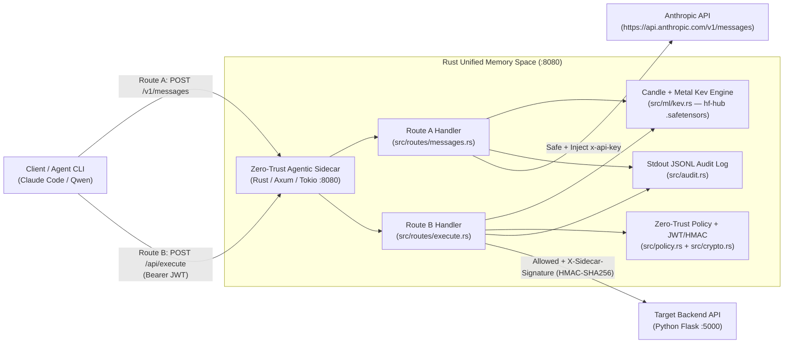

# Zero-Trust Agentic Sidecar — Step-by-Step Implementation Plan

## Goal Description

Build the **Zero-Trust Agentic Sidecar** enterprise AI security gateway as defined in [README.md](file:///Users/scottmcstay/Code/FA26/Zero-Trust-Agentic-Sidecar/README.md), [ARCHITECTURE.md](file:///Users/scottmcstay/Code/FA26/Zero-Trust-Agentic-Sidecar/ARCHITECTURE.md), and [design-doc.md](file:///Users/scottmcstay/Code/FA26/Zero-Trust-Agentic-Sidecar/design-doc.md).

The system consists of a **single high-performance Rust proxy crate** (`localhost:8080`) paired with a **Python Flask target backend** (`localhost:5000`):
1. **In-Process Native Rust ML Engine (`candle-core` + `candle-nn` + `hf-hub` + Metal)**:
   - Downloads the open-source **Kev System One decision model** (`jaredpalmer/kev-0.6b` `.safetensors` adapter, `Qwen/Qwen3-0.6B-Base` `.safetensors` backbone, `tokenizer.json`, and `PointerHead` weights) directly inside Rust via `hf-hub`.
   - Loads tensors onto Apple Silicon's **Metal GPU backend** (`Device::new_metal(0)`, with automatic `Device::Cpu` fallback), folds the PEFT LoRA adapter (`r=16, lora_alpha=32`) into the base weights at startup, and executes Kev's single-pass System One prefill + `PointerHead` readout (`<|fim_prefix|>`, `<|fim_middle|>`, `<|box_start|>`, `<|box_end|>`, `<|fim_suffix|>`) to output calibrated `injection_confidence` and `malicious_intent` probabilities in `~4ms`.
2. **Route A: Inbound Message Gateway (`POST /v1/messages`)**:
   - Intercepts chat prompts from Claude Code CLI or local Qwen/Ollama (`ANTHROPIC_BASE_URL="http://localhost:8080"`).
   - Evaluates prompt blocks in parallel with the in-process Candle/Kev model across overlapping windows.
   - Drops prompts where `injection_confidence >= max_injection_confidence` or `malicious_intent >= max_malicious_intent` with `403 Forbidden`; otherwise injects `x-api-key: $ANTHROPIC_API_KEY` inside Rust memory and forwards/streams the response from `https://api.anthropic.com/v1/messages`.
3. **Route B: Outbound Tool Execution (`POST /api/execute`)**:
   - Intercepts JSON tool-call payloads exiting the agent.
   - Runs **parallel interrogation** (`tokio::join!`):
     - **Deterministic Zero-Trust Policy Engine (`policy.toml` + JWT)**: Verifies the caller's `Authorization: Bearer <JWT>` (HS256), checks endpoint allowlist (`/api/v1/system/status` vs `/api/v1/db/drop`), checks role permissions, and validates required arguments, `max_len`, and linear-time `regex` constraints.
     - **In-Process Candle Kev Model**: Evaluates `injection_confidence` on untrusted context and `malicious_intent` on `(user_prompt, endpoint, method, payload)`.
   - Drops unauthorized or high-risk requests with `403 Forbidden`; signs approved requests with `X-Sidecar-Timestamp` + `X-Sidecar-Signature` (`HMAC-SHA256(SIDECAR_SECRET, "{ts}.{body}")`) and forwards them to the Python Flask backend (`localhost:5000`).
4. **Target Backend API (`backend/app.py` — Python Flask on `localhost:5000`)**:
   - Exposes safe endpoints (`/api/v1/system/status`, `/api/v1/email/send`) and vulnerable endpoints (`/api/v1/db/drop`).
   - Enforces `@app.before_request` HMAC-SHA256 verification (constant-time `hmac.compare_digest` + 30s replay window), rejecting any direct call that bypasses the Rust sidecar with `401 Unauthorized`.



---

## User Review Required

> [!IMPORTANT]
> **In-Rust Model Download (`hf-hub`) + Offline Test Mode**:
> - In production / standard runs (`cargo run --release`), `src/ml/kev.rs` uses `hf-hub` to download `jaredpalmer/kev-0.6b` (`adapter_model.safetensors`, `adapter_config.json`, `tokenizer.json`, `head.pt`) and `Qwen/Qwen3-0.6B-Base` (`config.json`, `model.safetensors`) directly into `models/` and runs them on Apple Silicon Metal (`candle-core` + `candle-nn`).
> - So that `cargo test` runs fast and deterministically in CI without requiring a 1.2 GB network download on every test run, `KevCandleEngine::new_random_or_seeded_for_test()` builds the exact same `candle-nn` Qwen + `PointerHead` architecture in memory with miniature dimensions (plus calibrated risk-signal projection weights) while `KevCandleEngine::load_from_hub(...)` performs the full Hugging Face `.safetensors` download and LoRA merge.

---

## Proposed Changes

### Component 1: Project Configuration & Workspace Manifests (Ticket T1)

#### [NEW] [Cargo.toml](file:///Users/scottmcstay/Code/FA26/Zero-Trust-Agentic-Sidecar/Cargo.toml)
Single-crate Rust manifest matching `cargo build --release` and `cargo run --release` in [README.md](file:///Users/scottmcstay/Code/FA26/Zero-Trust-Agentic-Sidecar/README.md):
```toml
[package]
name = "zero-trust-agentic-sidecar"
version = "0.1.0"
edition = "2021"
license = "MIT"

[features]
default = ["metal"]
metal = ["candle-core/metal", "candle-nn/metal", "candle-transformers/metal"]

[dependencies]
anyhow = "1.0"
async-trait = "0.1"
axum = { version = "0.7", features = ["macros"] }
bytes = "1.6"
candle-core = "0.8"
candle-nn = "0.8"
candle-transformers = "0.8"
chrono = { version = "0.4", features = ["serde"] }
futures-util = "0.3"
hex = "0.4"
hf-hub = "0.3"
hmac = "0.12"
jsonwebtoken = "9.3"
regex = "1.10"
reqwest = { version = "0.12", default-features = false, features = ["json", "stream", "rustls-tls"] }
safetensors = "0.4"
serde = { version = "1.0", features = ["derive"] }
serde_json = "1.0"
sha2 = "0.10"
subtle = "2.6"
thiserror = "1.0"
tokenizers = { version = "0.19", default-features = false, features = ["onig"] }
tokio = { version = "1.38", features = ["full"] }
toml = "0.8"
tower = { version = "0.4", features = ["util"] }
tracing = "0.1"
tracing-subscriber = { version = "0.3", features = ["env-filter", "json"] }
```

#### [NEW] [policy.toml](file:///Users/scottmcstay/Code/FA26/Zero-Trust-Agentic-Sidecar/policy.toml)
Deterministic zero-trust policy configuration for Route A thresholds and Route B endpoint rules:
```toml
[defaults]
max_injection_confidence = 0.70
max_malicious_intent = 0.50
model_timeout_ms = 500
fail_closed = true
require_jwt = true

[endpoints."/api/v1/system/status"]
backend_url = "http://127.0.0.1:5000/api/v1/system/status"
enabled = true
allowed_methods = ["GET", "POST"]
allowed_roles = ["agent", "admin", "readonly"]
required_args = ["service"]
constraints.service = { regex = "^[a-z0-9-]+$", max_len = 64 }

[endpoints."/api/v1/email/send"]
backend_url = "http://127.0.0.1:5000/api/v1/email/send"
enabled = true
allowed_methods = ["POST"]
allowed_roles = ["agent", "admin"]
required_args = ["to", "body"]
constraints.to = { regex = "^[^@]+@ourcompany\\.com$", max_len = 128 }
constraints.body = { max_len = 2000 }

[endpoints."/api/v1/db/drop"]
backend_url = "http://127.0.0.1:5000/api/v1/db/drop"
enabled = false
allowed_methods = ["POST"]
allowed_roles = []
required_args = ["table"]
```

#### [NEW] [.env.example](file:///Users/scottmcstay/Code/FA26/Zero-Trust-Agentic-Sidecar/.env.example)
Environment variable template for the Rust proxy and Python Flask backend.

---

### Component 2: Core Types, Config, Crypto & Policy Engine (Tickets T1, T2, T3, T5)

#### [NEW] [src/config.rs](file:///Users/scottmcstay/Code/FA26/Zero-Trust-Agentic-Sidecar/src/config.rs)
Loads and validates environment variables (`SIDECAR_ADDR`, `ANTHROPIC_API_KEY`, `UPSTREAM_LLM_URL`, `FLASK_BACKEND_URL`, `SIDECAR_SECRET`, `JWT_SECRET`, `POLICY_PATH`, `KEV_REPO_ID`, `KEV_BASE_REPO_ID`, `MODEL_CACHE_DIR`). Fails closed if `SIDECAR_SECRET` or `JWT_SECRET` is missing or empty.

#### [NEW] [src/types.rs](file:///Users/scottmcstay/Code/FA26/Zero-Trust-Agentic-Sidecar/src/types.rs)
Defines Serde contracts for Route A and Route B:
```rust
#[derive(Debug, Clone, Serialize, Deserialize, PartialEq)]
pub struct KevVerdict {
    pub injection_confidence: f32,
    pub malicious_intent: f32,
    pub model_id: String,
    pub reason: String,
}

#[derive(Debug, Clone, Copy, Serialize, Deserialize, PartialEq, Eq)]
#[serde(rename_all = "snake_case")]
pub enum DenyRule {
    Malformed,
    UnauthorizedToken,
    EndpointDenied,
    UnauthorizedRole,
    MissingArg,
    ConstraintFailed,
    ModelUnavailable,
    ModelRiskHigh,
    BackendError,
}

#[derive(Debug, Clone, Serialize, Deserialize)]
pub struct ToolExecuteRequest {
    pub session_id: String,
    pub endpoint: String,
    #[serde(default = "default_method")]
    pub method: String,
    #[serde(default)]
    pub payload: serde_json::Map<String, serde_json::Value>,
    #[serde(default)]
    pub context: ExecutionContext,
}
```

#### [NEW] [src/crypto.rs](file:///Users/scottmcstay/Code/FA26/Zero-Trust-Agentic-Sidecar/src/crypto.rs)
Implements two-legged cryptographic authorization:
1. **Inbound Agent JWT Verification (`Route B`)**:
   ```rust
   #[derive(Debug, Clone, Serialize, Deserialize, PartialEq, Eq)]
   pub struct AgentClaims {
       pub sub: String,
       pub role: String,
       pub exp: usize,
       #[serde(default)]
       pub payload_sha256: Option<String>,
   }

   pub fn verify_agent_jwt(
       token: &str,
       secret: &[u8],
       raw_payload: Option<&[u8]>,
   ) -> Result<AgentClaims, CryptoError>;
   ```
2. **Outbound Sidecar-to-Flask Signing (`HMAC-SHA256`)**:
   ```rust
   pub const HEADER_TIMESTAMP: &str = "X-Sidecar-Timestamp";
   pub const HEADER_SIGNATURE: &str = "X-Sidecar-Signature";
   pub const DEFAULT_MAX_SKEW_SECS: i64 = 30;

   pub fn sign_payload(secret: &[u8], timestamp: i64, body: &[u8]) -> String;
   pub fn verify_payload_signature(
       secret: &[u8],
       ts_header: &str,
       sig_header: &str,
       body: &[u8],
       now: i64,
       max_skew_secs: i64,
   ) -> Result<(), CryptoError>;
   ```

#### [NEW] [src/policy.rs](file:///Users/scottmcstay/Code/FA26/Zero-Trust-Agentic-Sidecar/src/policy.rs)
Loads `policy.toml`, pre-compiles all linear-time `regex::Regex` constraints at startup, and evaluates Route B tool-calls in strict priority order:
1. Endpoint listed in `policy.endpoints` and `enabled == true` → else `DenyRule::EndpointDenied`
2. `req.method` in `endpoint.allowed_methods` → else `DenyRule::EndpointDenied`
3. Caller `claims.role` in `endpoint.allowed_roles` → else `DenyRule::UnauthorizedRole`
4. Every key in `endpoint.required_args` present and non-null in `req.payload` → else `DenyRule::MissingArg`
5. Every `max_len` and `regex` constraint satisfied → else `DenyRule::ConstraintFailed`

#### [NEW] [src/audit.rs](file:///Users/scottmcstay/Code/FA26/Zero-Trust-Agentic-Sidecar/src/audit.rs)
Writes structured JSONL audit records to `stdout` (or a test buffer) for every Route A and Route B interception while redacting API keys, JWTs, and raw argument values.

---

### Component 3: In-Process Candle + Metal Kev `.safetensors` Engine (Ticket T4)

#### [NEW] [src/ml/mod.rs](file:///Users/scottmcstay/Code/FA26/Zero-Trust-Agentic-Sidecar/src/ml/mod.rs)
Defines the `DecisionEngine` trait and sliding-window chunker (`window_text`) so long prompts and untrusted inputs are scored across overlapping windows (retaining the maximum window `injection_confidence`):
```rust
#[async_trait]
pub trait DecisionEngine: Send + Sync {
    fn model_id(&self) -> &str;
    async fn evaluate_prompt(&self, prompt_text: &str) -> anyhow::Result<KevVerdict>;
    async fn evaluate_tool_call(&self, req: &ToolExecuteRequest) -> anyhow::Result<KevVerdict>;
}
```

#### [NEW] [src/ml/kev.rs](file:///Users/scottmcstay/Code/FA26/Zero-Trust-Agentic-Sidecar/src/ml/kev.rs)
Native Rust `candle-core` + `candle-nn` implementation of the Kev System One decision model:
- **Device Initialization**:
  ```rust
  pub fn select_device() -> Device {
      #[cfg(feature = "metal")]
      if let Ok(dev) = Device::new_metal(0) {
          return dev;
      }
      Device::Cpu
  }
  ```
- **Direct Hugging Face Download in Rust (`hf-hub`)**:
  ```rust
  pub fn download_kev_artifacts(
      kev_repo_id: &str,
      base_repo_id: &str,
      cache_dir: &Path,
  ) -> anyhow::Result<KevModelPaths> {
      let api = hf_hub::api::sync::ApiBuilder::new()
          .with_cache_dir(cache_dir.to_path_buf())
          .build()?;
      let kev_repo = api.model(kev_repo_id.to_string());
      let base_repo = api.model(base_repo_id.to_string());
      Ok(KevModelPaths {
          tokenizer_json: kev_repo.get("tokenizer.json")?,
          adapter_config_json: kev_repo.get("adapter_config.json")?,
          adapter_safetensors: kev_repo.get("adapter_model.safetensors")?,
          base_config_json: base_repo.get("config.json")?,
          base_safetensors: base_repo.get("model.safetensors")?,
      })
  }
  ```
- **LoRA `.safetensors` Folding in `candle-nn`**:
  - Loads base `.safetensors` and `adapter_model.safetensors` into `candle_core::Tensor` maps on the Metal/CPU device.
  - Folds each LoRA pair (`lora_A.weight`, `lora_B.weight`) into the corresponding base weight tensor:
    ```rust
    let scale = (lora_alpha as f64) / (lora_r as f64);
    let delta = lora_b.matmul(&lora_a)? * scale;
    let merged = (base_w.to_dtype(DType::F32)? + delta?)?;
    ```
- **Single-Pass System One Prefill & `PointerHead` (`candle_nn::Linear`)**:
  - Packs the state and `noul` question using Kev's special delimiters (`<|fim_prefix|>`, `<|fim_middle|>`, `<|box_start|>`, `<|box_end|>`, `<|fim_suffix|>`).
  - Runs the forward pass through `candle-nn` layers inside `tokio::task::spawn_blocking` (bounded by a concurrency `Semaphore`).
  - Computes calibrated `PointerHead` logits over the `"no"` and `"yes"` `</opt>` hidden vectors against the `<decide>` hidden vector, applying temperature scaling and `candle_nn::ops::softmax` to extract `injection_confidence` and `malicious_intent` in `[0.0, 1.0]`.

---

### Component 4: Axum Server & Route Handlers (Tickets T6, T7)

#### [NEW] [src/routes/messages.rs](file:///Users/scottmcstay/Code/FA26/Zero-Trust-Agentic-Sidecar/src/routes/messages.rs)
Implements **Route A (`POST /v1/messages`)**:
1. Parses the inbound Anthropic `/v1/messages` JSON payload and flattens all text content across `system`, `user`, and `tool_result` blocks.
2. Runs `tokio::time::timeout(model_timeout, state.engine.evaluate_prompt(&extracted_text))`.
3. If `verdict.injection_confidence >= max_injection_confidence` or `verdict.malicious_intent >= max_malicious_intent` (or model fails/times out) → logs a deny `AuditEntry` and returns `403 Forbidden`.
4. If safe → injects `x-api-key: state.config.anthropic_api_key` and `anthropic-version: 2023-06-01`, forwards the JSON body to `state.config.upstream_llm_url` via `reqwest::Client`, and streams the response body (`Body::from_stream(upstream_resp.bytes_stream())`) back to the client.

#### [NEW] [src/routes/execute.rs](file:///Users/scottmcstay/Code/FA26/Zero-Trust-Agentic-Sidecar/src/routes/execute.rs)
Implements **Route B (`POST /api/execute`)**:
1. Extracts `Authorization: Bearer <JWT>` and parses `ToolExecuteRequest` (returning `400 Bad Request` with `DenyRule::Malformed` on invalid JSON).
2. Runs deterministic policy/JWT checks and `tokio::time::timeout(model_timeout, state.engine.evaluate_tool_call(&req))` in parallel via `tokio::join!`.
3. Enforces the 7-step deterministic decision order (`malformed` → `unauthorized_token` → `endpoint_denied` → `unauthorized_role` → `missing_arg` → `constraint_failed` → `model_unavailable` → `model_risk_high`).
4. If allowed → serializes `req.payload`, signs it with `crypto::sign_payload(&state.config.sidecar_secret, ts, &body_bytes)`, attaches `X-Sidecar-Timestamp` and `X-Sidecar-Signature`, and forwards the request to the target Flask backend URL (`localhost:5000`).

#### [NEW] [src/routes/mod.rs](file:///Users/scottmcstay/Code/FA26/Zero-Trust-Agentic-Sidecar/src/routes/mod.rs), [src/lib.rs](file:///Users/scottmcstay/Code/FA26/Zero-Trust-Agentic-Sidecar/src/lib.rs), & [src/main.rs](file:///Users/scottmcstay/Code/FA26/Zero-Trust-Agentic-Sidecar/src/main.rs)
Wires up `GET /healthz`, `POST /v1/messages` (Route A), and `POST /api/execute` (Route B) on `localhost:8080`.

---

### Component 5: Target Backend API in Python Flask (Ticket T8)

#### [NEW] [backend/app.py](file:///Users/scottmcstay/Code/FA26/Zero-Trust-Agentic-Sidecar/backend/app.py)
Python Flask server listening on `localhost:5000`:
```python
import hashlib
import hmac
import os
import time
from flask import Flask, jsonify, request

def create_app(secret: str | None = None) -> Flask:
    app = Flask(__name__)
    app.config["SIDECAR_SECRET"] = (
        secret or os.environ.get("SIDECAR_SECRET", "")
    ).encode("utf-8")
    app.config["MAX_SKEW_SECONDS"] = 30

    @app.before_request
    def verify_sidecar_signature():
        if request.path == "/healthz":
            return None
        secret_bytes = app.config["SIDECAR_SECRET"]
        if not secret_bytes:
            return jsonify({"error": "server misconfigured: missing SIDECAR_SECRET"}), 500

        ts_header = request.headers.get("X-Sidecar-Timestamp")
        sig_header = request.headers.get("X-Sidecar-Signature")
        if not ts_header or not sig_header:
            return jsonify({"error": "unauthorized: missing sidecar signature headers"}), 401

        try:
            ts = int(ts_header)
        except ValueError:
            return jsonify({"error": "unauthorized: invalid timestamp"}), 401

        if abs(int(time.time()) - ts) > app.config["MAX_SKEW_SECONDS"]:
            return jsonify({"error": "unauthorized: signature timestamp expired"}), 401

        raw_body = request.get_data()
        signing_input = f"{ts}.".encode("utf-8") + raw_body
        expected_sig = hmac.new(secret_bytes, signing_input, hashlib.sha256).hexdigest()
        if not hmac.compare_digest(expected_sig, sig_header.lower()):
            return jsonify({"error": "unauthorized: signature mismatch"}), 401
        return None

    @app.route("/api/v1/system/status", methods=["GET", "POST"])
    def system_status():
        data = request.get_json(silent=True) or {}
        return jsonify({
            "status": "healthy",
            "service": data.get("service", "core"),
            "uptime_seconds": 86400,
        }), 200

    @app.route("/api/v1/email/send", methods=["POST"])
    def send_email():
        data = request.get_json(silent=True) or {}
        return jsonify({
            "status": "sent",
            "to": data.get("to"),
        }), 200

    @app.route("/api/v1/db/drop", methods=["POST"])
    def drop_db():
        data = request.get_json(silent=True) or {}
        return jsonify({
            "status": "dropped",
            "table": data.get("table"),
        }), 200

    return app
```

#### [NEW] [backend/requirements.txt](file:///Users/scottmcstay/Code/FA26/Zero-Trust-Agentic-Sidecar/backend/requirements.txt) & [backend/test_backend.py](file:///Users/scottmcstay/Code/FA26/Zero-Trust-Agentic-Sidecar/backend/test_backend.py)
Pytest test suite verifying Flask HMAC signature enforcement (`401` on missing/expired/tampered signature, `200` on valid sidecar signature).

---

### Component 6: End-to-End Integration Suite (Ticket T9)

#### [NEW] [tests/e2e.rs](file:///Users/scottmcstay/Code/FA26/Zero-Trust-Agentic-Sidecar/tests/e2e.rs)
Spawns mock upstream Anthropic LLM server, mock/Flask backend verifier, and the Axum sidecar on ephemeral ports to test:
1. **Route A Safe Prompt**: Evaluates prompt via Candle Kev engine, injects `x-api-key`, forwards to upstream LLM, and streams response back (`200 OK`).
2. **Route A Prompt Injection Blocked**: Prompt containing injection instructions is caught by Kev engine and blocked with `403 Forbidden` before reaching upstream LLM.
3. **Route B Safe Tool Execution (`/api/v1/system/status`)**: Valid JWT + valid args + clean Kev scores → signed with `X-Sidecar-Signature` and executed by backend (`200 OK`).
4. **Route B Vulnerable Endpoint Blocked (`/api/v1/db/drop`)**: Blocked by zero-trust policy (`403 Forbidden`, `rule: "endpoint_denied"`).
5. **Route B Regex Constraint Blocked (`/api/v1/email/send`)**: Recipient `attacker@evil.com` blocked by regex constraint (`403 Forbidden`, `rule: "constraint_failed"`).
6. **Route B Missing / Invalid JWT Blocked**: Missing or tampered bearer token rejected (`403 Forbidden`, `rule: "unauthorized_token"`).
7. **Route B Indirect Prompt Injection / Malicious Intent Blocked**: Hostile instructions in `context.untrusted_inputs` or intent mismatch blocked by Kev engine (`403 Forbidden`, `rule: "model_risk_high"`).
8. **Choke-Point Bypass Blocked (`401`)**: Direct unsigned request to backend is rejected with `401 Unauthorized`.

---

## Verification Plan

### Automated Tests
```bash
# 1. Format & Clippy lint check
cargo fmt --all -- --check
cargo clippy --all-targets -- -D warnings

# 2. Build release binary
cargo build --release

# 3. Run all Rust unit & E2E integration tests
cargo test

# 4. Run Python Flask backend tests
python3 -m pytest backend/test_backend.py
```

### Manual Verification
1. Start the Python Flask target backend on `:5000`:
   ```bash
   SIDECAR_SECRET=super-secret-key python3 backend/app.py
   ```
2. Start the Rust Zero-Trust Agentic Sidecar on `:8080`:
   ```bash
   SIDECAR_SECRET=super-secret-key JWT_SECRET=agent-jwt-secret ANTHROPIC_API_KEY=sk-ant-demo cargo run --release
   ```
3. Verify Route A (`POST http://localhost:8080/v1/messages`) and Route B (`POST http://localhost:8080/api/execute`) with `curl`.
